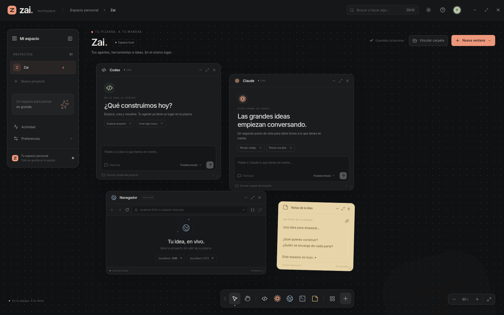

# zai.

**Tus agentes, herramientas e ideas. En el mismo lugar.**

Una pizarra de escritorio con un espacio independiente para cada proyecto.
Abre chats de Codex, Claude y Zai Agent, un navegador, terminales y notas; mueve las ventanas
a tu gusto o conviértelas en iconos sin detener sus sesiones.



## Lo que incluye

- Chats propios de Codex y Claude con respuestas en streaming, Markdown, herramientas,
  errores y solicitudes de permiso. Conexión a los agentes locales mediante sus
  interfaces oficiales.
- Selectores de modelo, esfuerzo y velocidad por chat, consultados a cada agente.
  Menús con búsqueda de modelos, descripciones, selección por teclado y adaptación
  al espacio disponible. Límites de cuenta con porcentajes y reinicios cuando el proveedor los publica.
- Permisos nativos por chat: acceso a archivos, aprobaciones y red en Codex;
  modos de permisos de Claude, incluida la aceptación de ediciones y planificación.
- Conexiones entre chats y navegadores mediante puntos que puedes arrastrar.
  Los agentes pueden leer y controlar los navegadores conectados con herramientas
  MCP propias. El hilo muestra pulsos al realizar acciones y devolver resultados.
- Mensajes y herramientas en secuencia cronológica, conservada al reabrir la app.
- Ventanas movibles y redimensionables, ampliación, iconos movibles y organización
  automática. La barra superior reúne todas las ventanas minimizadas y permite
  restaurarlas, incluso desde otro proyecto o fuera del área visible. Los borradores y las páginas permanecen abiertos al minimizar.
- Proyectos con carpeta, conversaciones y distribución independientes. Cambiar de
  estancia mantiene los agentes activos.
- Navegador Chromium integrado, navegación atrás y adelante, recarga y herramientas
  de desarrollo. Las páginas están aisladas del acceso a Node y a la API de Zai.
- Terminal real en la carpeta del proyecto y notas editables.
- Registro de actividad, guardado local, exportación e importación de copias.
- Tema claro y oscuro, colores de acento, panel de proyectos y barra movibles,
  pizarra con desplazamiento y zoom y buscador de acciones.

## Zai Agent, APIs y fondos

Zai Agent es un motor original incluido en la aplicación, sin instalar otro CLI.
En **Preferencias → Conexiones de IA**, agrega DeepSeek, OpenRouter, Ollama Cloud,
Ollama local o una API de chat compatible. Abre **Nueva ventana → Zai Agent**,
elige la conexión y vincula la carpeta del proyecto. Los modelos se consultan al
servidor; también puedes indicar uno manualmente. Ollama Cloud se conecta
directamente; Ollama local necesita que su servicio y sus modelos estén instalados.

El motor ofrece streaming, archivos y búsquedas dentro del proyecto, ediciones,
terminal, planes, preguntas, skills, revisiones con un subagente de solo lectura,
sesiones persistentes y compacción de contexto. Descubre `SKILL.md` del proyecto
y del usuario, y lee `AGENTS.md`, `CLAUDE.md` y `.zai/instructions.md` de la raíz.
Las escrituras guardan una copia anterior dentro del directorio de la sesión.
Los modos son Preguntar, Ediciones, Plan y Autónomo. **Los comandos se ejecutan
con los permisos de tu usuario; este motor no incluye un sandbox del sistema.**
El acceso a navegadores se controla con los mismos cables y aprobaciones.

Esta primera versión no reproduce todas las funciones de Claude Code: no tiene
su sistema de plugins, hooks, equipos, servidores MCP externos configurables,
memoria automática ni restauración gráfica de checkpoints. Las revisiones
secundarias son de solo lectura. Su utilidad depende del soporte de herramientas
y la calidad del modelo. La [investigación de motores](reports/Motor%20de%20agentes%20para%20Zai.md)
compara el diseño propio, Pi y OpenCode y describe las diferencias.

Las claves se conservan en el proceso principal y se cifran con el almacén del
sistema cuando está disponible. Si Linux usa `basic_text`, o el almacén está
bloqueado, la clave dura solo la sesión y la interfaz lo indica. No se guardan en
`workspace.json` ni en las exportaciones. Cambiar el servidor elimina la clave
anterior y reinicia el contexto del agente.

En **Preferencias → El fondo de tu espacio** puedes elegir un color, importar una
imagen y ajustar su intensidad. **Crear con IA** admite OpenRouter, una API de
imágenes compatible, Automatic1111/Forge (`--api`) y ComfyUI. Para ComfyUI pega un
workflow exportado en formato API con `{{prompt}}` en el texto positivo. Los
motores y modelos locales se instalan por separado; Zai conecta sus servicios.
La generación remota usa tu cuenta y puede tener coste. Cancelar deja de esperar;
el servidor local puede continuar su tarea. Las imágenes se copian a la biblioteca
local de Zai y no viajan dentro de una copia JSON de la pizarra.

## Rendimiento y GPU

La aceleración por hardware está en modo automático: Chromium utiliza la GPU
cuando la tarjeta y su controlador lo permiten. **Preferencias → Rendimiento y
gráficos** muestra el estado real de composición, rasterización y WebGL, y permite
desactivar/reactivar ese modo para el próximo inicio. Los fallos o incompatibilidades
del controlador mantienen la alternativa de software; no se fuerza una GPU bloqueada.

El arrastre mueve la ventana y los cables una vez por fotograma, sin reconstruir
los chats ni guardar la pizarra por cada movimiento. La posición se confirma al
soltar el ratón. La transformación de composición se retira al terminar, y el
zoom de reposo conserva el texto nítido. Los mensajes anteriores se reutilizan
cuando llega un nuevo fragmento de respuesta. Las preferencias se cargan al abrirlas.

## Ejecutar

Para desarrollar necesitas Node.js 24. Codex y Claude requieren sus CLI y una
sesión iniciada; Zai Agent usa las conexiones configuradas dentro de la app.
La instalación empaquetada incluye el motor de Zai y no necesita Node externo.

```sh
npm ci
npm run dev
```

Para abrir la compilación de producción:

```sh
npm run build
npm start
```

Para usar Codex, instala [Codex CLI](https://developers.openai.com/codex/cli/) y
ejecuta `codex login`. Para Claude, instala
[Claude Code](https://code.claude.com/docs/en/overview) y ejecuta `claude auth login`.
Zai utiliza sus sesiones locales y no requiere una clave API propia.

Dentro de Zai, vincula la carpeta de un proyecto y escribe en un chat. El selector
de modelo ofrece el catálogo de la CLI o un identificador personalizado. También
puedes elegir esfuerzo y velocidad cuando el modelo los admita. El modo rápido
puede consumir más cuota o tener un coste mayor. En «Uso» se muestran únicamente
los periodos publicados por la cuenta (5 horas, semanal, mensual u otros), con
su porcentaje y fecha de reinicio. Algunas conexiones por API o proveedores
personalizados no exponen estos límites; Zai lo indica y muestra el consumo de
la conversación cuando el agente lo informa.
Las operaciones que el proveedor someta a aprobación aparecerán en el chat.

El icono de escudo abre «Permisos». Codex permite elegir solo lectura, escritura
en el proyecto o acceso completo, junto con su política de aprobaciones y acceso
a red de los comandos. Claude ofrece sus modos nativos de aprobación. Las opciones
se aplican al siguiente turno y quedan guardadas en ese chat.

Para conectar un navegador, arrastra uno de los puntos de su cabecera hasta un
punto de Codex, Claude o Zai Agent en el mismo proyecto. También puedes pulsar ambos puntos
con el ratón o con Enter. Pide al agente que use el navegador conectado: puede
navegar, leer la página, pulsar elementos, escribir en campos, elegir opciones,
enviar teclas, desplazarse y tomar capturas. El acceso del navegador se configura
por separado en «Permisos»: solo lectura, preguntar por cada interacción o control.
Los modos de solo lectura de Codex y Plan de Claude impiden modificar el navegador.
Los pulsos del hilo corresponden a acciones reales, incluso al minimizar la ventana.
La lectura sigue disponible al minimizar; para tomar capturas, restaura el navegador
y mantén visible su proyecto en la pizarra.
Para desconectar, abre el indicador de conexiones en el pie del navegador, o
selecciona el hilo y pulsa Supr/Backspace o su botón. Durante una operación activa
o en cola del navegador la desconexión se bloquea; vuelve a estar disponible al
terminar. Desconectarlo revoca el acceso y cancela aprobaciones pendientes.

`npm run dev:web` abre la vista previa en `http://127.0.0.1:4317`. En ese modo puedes
probar la pizarra y el guardado en el navegador; los agentes, las carpetas, la
terminal y el navegador integrado necesitan Electron.

## Sistemas y paquetes

La aplicación usa Electron y tiene configuración de empaquetado para:

| Sistema | Paquete |
| --- | --- |
| Linux, incluido Fedora | AppImage y RPM |
| Windows | Instalador NSIS |
| macOS | DMG |

```sh
npm run dist
```

Construye en el sistema de destino para compilar sus dependencias nativas.
Los paquetes aparecen en `release/`. La firma de distribución de Windows y macOS
requiere configurar certificados propios; no se incluyen certificados en el repo.

Si Fedora no tiene FUSE 2, puedes abrir el AppImage sin instalarlo utilizando el
modo de extracción, también probado con el navegador y la terminal:

```sh
APPIMAGE_EXTRACT_AND_RUN=1 ./release/Zai-0.4.0.AppImage
```

La versión inicial se ha probado localmente en Fedora. El workflow de CI está
preparado para verificar compilación, interfaz, Electron y empaquetado en Linux,
Windows y macOS. Esto no sustituye pruebas manuales en los tres sistemas.

En Fedora, la compilación de `node-pty` puede necesitar `gcc-c++`, `make` y Python.
Para generar RPM instala también las herramientas de RPM de tu sistema.

## Atajos

| Acción | Atajo |
| --- | --- |
| Buscar acciones | Ctrl K / ⌘ K |
| Mover la pizarra | Espacio + arrastrar, H o botón central |
| Seleccionar | V |
| Encuadrar ventanas | F |
| Nueva nota | N |
| Zoom | Ctrl / ⌘ + rueda |
| Enviar / nueva línea | Enter / Shift Enter |

## Validación

```sh
npm run check
npm run test:unit
npx playwright install chromium
npm test
npm run build
npm run test:desktop
npm run test:providers
```

En Linux sin sesión gráfica, ejecuta la prueba de escritorio con
`xvfb-run -a -s '-screen 0 1920x1080x24' npm run test:desktop`.
Las pruebas automáticas usan perfiles y carpetas temporales. La prueba de protocolos
inicia las CLI sin enviar un prompt ni pedir una inferencia. Los adaptadores API
y la generación de fondos se prueban con servidores HTTP aislados y respuestas
simuladas; no se realizan inferencias pagadas ni se utilizan claves personales.

También se verificó una respuesta real de ambos agentes usando los conectores de
Zai, sin solicitar herramientas ni modificaciones de archivos.

Consulta [la arquitectura](docs/architecture.md) para los protocolos y la
separación entre interfaz y procesos. T3 Code se consultó como referencia de
arquitectura; esta implementación se escribió desde cero, sin incorporar código
de ese proyecto.

## Licencia

Proyecto de [Yordi (Y0RD1N)](https://github.com/Y0RD1N), distribuido bajo la
[licencia MIT](LICENSE). Al reutilizar copias o partes sustanciales del código,
se deben conservar su aviso de copyright y de licencia. Las dependencias conservan
sus respectivas licencias.
