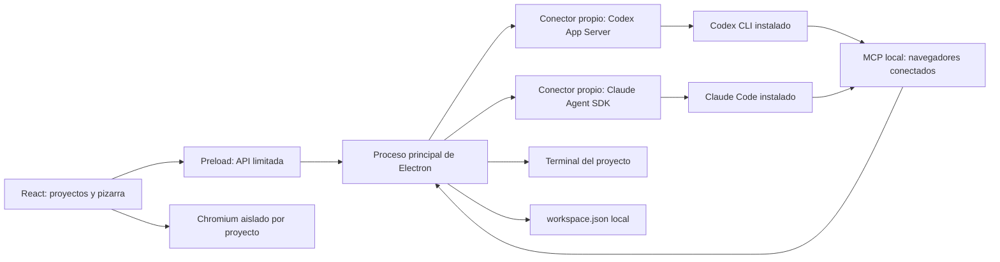

# Arquitectura de Zai

Zai es una aplicación de escritorio escrita desde cero en Electron, React y TypeScript.
T3 Code se consultó como referencia para entender su separación entre proveedores e interfaz.
No se copió ni se incorporó código de ese proyecto.

## Conectores de agentes

`electron/agents.cjs` contiene los dos conectores. Traducen sus protocolos a eventos
de mensajes, sesiones, herramientas, estados, errores y permisos.

Codex se inicia mediante `codex app-server --listen stdio://`. El conector completa
`initialize` y `initialized`, crea o reanuda un hilo y envía cada mensaje con
`turn/start`. Los eventos se leen como JSON por líneas. Las solicitudes de permiso
esperan una decisión del usuario; una aprobación concede una operación, no acceso
permanente. Se conserva el identificador del hilo para reanudarlo.

Claude usa `query()` del SDK oficial y el ejecutable instalado de Claude Code.
Cada turno recibe eventos estructurados y conserva su identificador de sesión para
continuar la conversación. `canUseTool` lleva los permisos a la ventana del chat.
Detener un turno cancela su consulta.

Los proveedores usan la autenticación que ya maneja su CLI. Zai no lee ni copia sus
archivos de credenciales. No reemplaza sus modelos por uno fijo: por defecto usa la
configuración del proveedor y permite indicar un modelo en cada ventana.

### Permisos por chat

`electron/permissions.cjs` valida las opciones con listas cerradas. Codex recibe
`sandbox` y `approvalPolicy` al iniciar o reanudar el hilo y una `sandboxPolicy`
explícita en cada turno. La escritura se limita a la carpeta del proyecto, con
acceso a red configurable; solo lectura y acceso completo usan sus políticas nativas.

Claude recibe `permissionMode` en cada consulta. Zai ofrece `default`, `acceptEdits`,
`plan`, `dontAsk` y `bypassPermissions`; `allowDangerouslySkipPermissions` solo se
activa cuando el usuario elige el último. Se mantienen las reglas y los controles
obligatorios del proveedor. Los cambios se bloquean mientras hay un turno activo.
Las copias importadas restablecen estos permisos a sus valores iniciales.

### Modelos, esfuerzo, velocidad y uso

`electron/providers.cjs` consulta un catálogo compartido por proveedor, sin enviar
prompts ni crear hilos de trabajo. Codex expone `model/list`, `config/read` y
`account/rateLimits/read`. Se usan los esfuerzos y `serviceTiers` de cada fila;
`turn/start` recibe `model`, `effort` y `serviceTier` en cada turno. Volver a la
velocidad estándar envía `default` explícitamente para evitar heredar el modo rápido.

Claude expone modelos y capacidades mediante `initializationResult()` del Agent
SDK. Cada consulta recibe `model`, `effort` y una capa de ajustes de sesión
`settings.fastMode`; no se modifican los ajustes del usuario. El estado de fast
mode informado por el agente permite mostrar sus pausas y cambios a velocidad
estándar. Los modelos sin capacidad anunciada no ofrecen ese control.

Los límites de Claude se consultan, si existe, mediante el control opcional
`usage_EXPERIMENTAL_MAY_CHANGE_DO_NOT_RELY_ON_THIS_API_YET({skipBehaviors:true})`.
Es una API experimental: se comprueba su presencia, se limita el tiempo de espera
y se admite que falte o falle. Los eventos `rate_limit_event` complementan los
datos durante el chat. No se leen tokens ni se llaman endpoints privados para
suplir su ausencia. Una conexión por API puede no exponer cuota de cuenta.

Los periodos se derivan de las ventanas que informa cada proveedor, sin asumir
que la ventana principal siempre dura cinco horas. Los datos ausentes no se
convierten en cero. Las cuotas se mantienen en memoria, se actualizan cada dos
minutos con la app visible, al terminar un turno y con el botón de actualización.
Las notificaciones parciales se combinan con las ventanas ya conocidas. Los
tokens y el coste estimado de una conversación se muestran por separado.

### Secuencia del chat

Cada chat guarda un `timeline` de referencias a mensajes y acciones. El primer
evento añade una entrada; los deltas, resultados y cambios de estado actualizan
esa entrada sin moverla. Los bloques de texto de Claude tienen identificadores
independientes para poder intercalar herramientas y texto. Los argumentos de una
herramienta se completan en su tarjeta original, y el resultado final permanece
en su posición posterior a las acciones que lo precedieron. La secuencia y los
resultados de herramientas se conservan al reiniciar; las acciones que quedaron
activas se muestran interrumpidas tras restaurar el archivo.

## Proyectos y ventanas

Cada proyecto guarda su carpeta, ventanas, notas, conversación, zoom y posición de
la pizarra. Los proyectos comparten el proceso de escritorio, y cada chat tiene una
instancia independiente de su proveedor. Minimizar y cambiar de proyecto oculta
los componentes sin desmontarlos. Las sesiones siguen activas hasta cerrar su
ventana o salir de la aplicación.

La capa transformada de ventanas tiene su propio contexto de apilamiento, por
encima del título del proyecto y por debajo de los controles de la pizarra. La
barra superior reúne las ventanas minimizadas de todos los proyectos. Restaurar
desde esa lista cambia al proyecto correspondiente, lleva la ventana al frente
y centra el área visible en ella sin desmontar el componente.

La distribución y los mensajes se guardan en `workspace.json`, en el directorio
`userData` de Electron. La escritura se serializa y utiliza un archivo temporal y
un cambio de nombre. Los controles flotantes y la apariencia también se guardan.
El registro de actividad está limitado a 150 entradas.

Las copias importadas crean identificadores nuevos y eliminan las referencias a
sesiones y carpetas. Así no se conectan a una conversación ajena ni ejecutan agentes
en una ruta procedente del archivo importado.

## Navegador y límites de procesos

El navegador usa un `webview` de Electron para integrarse en la composición y el
orden de las ventanas del lienzo. Solo permite HTTP y HTTPS. Cada proyecto tiene
una partición de sesión persistente. El proceso principal impone sandbox,
aislamiento de contexto y ausencia de integración con Node; los sitios no reciben
el puente de Zai. Se conservan las protecciones de seguridad del navegador.
Las ventanas emergentes de autenticación utilizan ventanas de navegador aisladas.

### Conexiones y herramientas del navegador

Cada proyecto guarda aristas entre sus chats y navegadores. `Connections.tsx`
dibuja curvas SVG que siguen la posición de las ventanas, el zoom y sus iconos
minimizados. Los puntos admiten arrastrar y soltar o conexión mediante teclado.
Las partículas solo se activan por eventos de operaciones reales del controlador:
petición hacia el navegador, resultado de vuelta y señal de error si falla.

`electron/browser-hub.cjs` implementa MCP por HTTP en un puerto aleatorio de
loopback. Cada chat obtiene un token aleatorio independiente, conservado en memoria.
El servidor rechaza peticiones con Origin y solo acepta clientes autenticados.
Codex recibe `mcp_servers.zai_browser` mediante la configuración del hilo; Claude
recibe el servidor HTTP en `mcpServers`. Ambos descubren las mismas nueve
herramientas propias sin copiar implementaciones de otros proyectos.

Cada llamada verifica que hay un turno activo y una conexión al navegador dentro
del mismo proyecto. Las mutaciones respetan el acceso del navegador (leer,
preguntar o controlar), además de los modos restrictivos del agente. La aprobación
es para una sola operación y se cancela al desconectar o detener el turno. Las
acciones se serializan por navegador. Quitar la conexión o cerrar el chat revoca
su acceso; cerrar el chat también elimina su token.

`electron/browser-controller.cjs` comprueba que cada webview pertenece a la ventana
principal y a la partición del proyecto. Ofrece navegación HTTP(S), lectura,
clic, campos, selectores, teclas, desplazamiento y capturas. La lectura asigna
referencias temporales a elementos visibles y omite valores de contraseñas.
Las referencias y las operaciones DOM residen en un mundo aislado de Chromium;
los clics y teclas se envían a ese webview mediante el protocolo de depuración.
No se ejecuta JavaScript arbitrario proporcionado por el modelo. La implementación
actual opera sobre el documento principal; no incluye carga de archivos ni control
del escritorio. Las páginas siguen sin recibir el puente de Zai ni acceso a Node.

Los procesos de agentes, las terminales y el almacenamiento pertenecen al proceso
principal. El renderer solo recibe una API concreta en `electron/preload.cjs`.
El proceso principal valida el emisor de cada llamada. Cerrar una ventana termina
su agente o terminal; salir termina los procesos que aún pertenecen a Zai.

## Referencias de protocolo

- [Codex App Server](https://developers.openai.com/codex/app-server/)
- [MCP en Codex](https://developers.openai.com/codex/mcp/)
- [Claude Agent SDK](https://platform.claude.com/docs/en/agent-sdk/overview)
- [Permisos del SDK de Claude](https://platform.claude.com/docs/en/agent-sdk/permissions)
- [MCP en el SDK de Claude](https://platform.claude.com/docs/en/agent-sdk/mcp)
- [Fast mode de Claude Code](https://code.claude.com/docs/en/fast-mode)
- [Referencia TypeScript del SDK](https://github.com/anthropics/claude-agent-sdk-typescript)
- [Arquitectura de T3 Code](https://github.com/pingdotgg/t3code/blob/main/docs/internals/overview.md)
